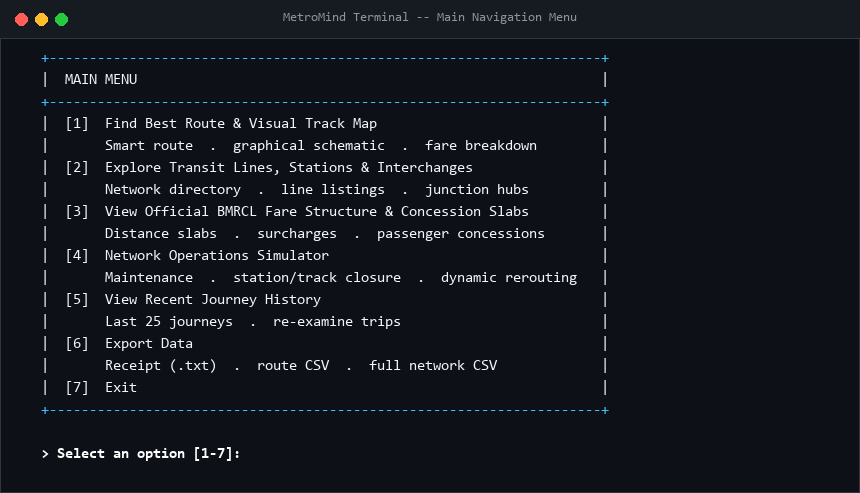
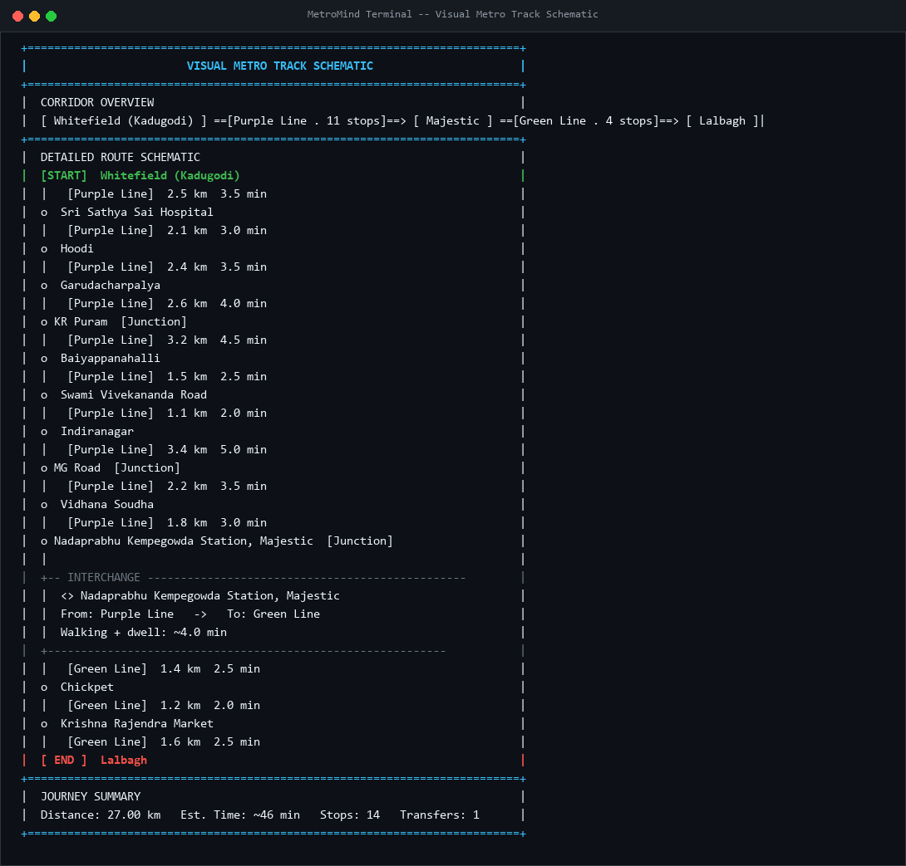
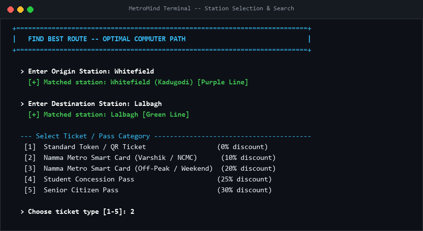
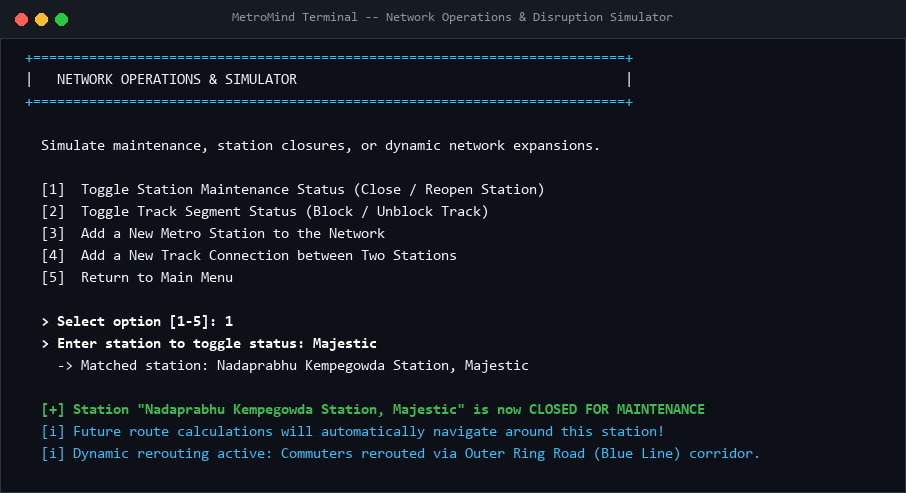
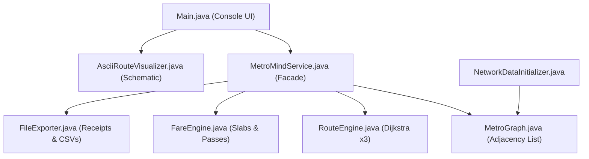

<div align="center">

# 🚇 METROMIND
### Smart Metro Route & Fare Computation Engine

A Java-based Bengaluru Metro route planner featuring Dijkstra’s shortest-path algorithms, fare calculation, interchange optimization, and network disruption simulation.
**Bengaluru Namma Metro (BMRCL) Edition**

[](https://www.oracle.com/java/)
[](src/)
[](src/util/NetworkDataInitializer.java)
[](src/route/RouteEngine.java)
[](src/MetroMindTest.java)

A high-performance transit navigation, shortest-route optimization, and automated fare auditing engine designed for the **Bengaluru Namma Metro** network. Engineered in pure Java 17 with state-expanded graph algorithms, slab-based pricing, network disruption simulation, and a terminal track schematic.

[Overview](#-overview) • [Preview](#-application-preview) • [Features](#-key-features) • [Architecture](#-system-architecture) • [Routing](#-how-routing-works) • [Quick Start](#-getting-started) • [Docs](#-detailed-documentation)

---

</div>

## 📌 Overview

MetroMind models the **Bengaluru Namma Metro (BMRCL)** transit grid as a weighted directed graph covering 63 stations across 5 lines (*Purple, Green, Yellow, Pink, Blue*). Standard transit algorithms minimize only distance or time, ignoring the physical fatigue of switching platforms at massive interchange hubs like *Majestic* or *Silk Board*. MetroMind computes candidate paths across three dimensions—physical distance, travel time, and interchange count—and resolves them using a **Commuter Friction Cost Function** to deliver a single, practically optimal recommendation with deterministic fare computation.

---

## 📸 Application Preview

<div align="center">

| 1. Startup & Network Summary | 2. Main Navigation Menu |
| :---: | :---: |
|  |  |
| *63-station network status across 5 transit lines* | *Modular 7-option interactive menu system* |

| 3. Visual Track Schematic | 4. Fare Breakdown & Matrix |
| :---: | :---: |
|  |  |
| *Corridor overview, milestone stops, and transfer bridge* | *Distance slab, concession savings, and pass comparison* |

| 5. Station Search & Auto-Matching | 6. Disruption Simulator & Rerouting |
| :---: | :---: |
|  |  |
| *Case-insensitive partial matching and ticket selection* | *Station/track closure with dynamic Outer Ring Road rerouting* |

</div>

---

## ✨ Key Features

| Feature | Description |
|---|---|
| **Multi-Criteria Dijkstra** | Runs 3 Dijkstra variants: shortest physical distance, fastest travel time, and fewest line interchanges. |
| **Friction-Score Best Route** | Automatically balances duration, line transfers, and track distance via commuter friction heuristic. |
| **Terminal Track Schematic** | Renders an ASCII/Unicode track map with station nodes, interchange bridges, and commute metrics. |
| **Slab-Based Fare Engine** | Accurately calculates official BMRCL distance slabs (₹10 to ₹60) with a ₹10.00 minimum fare floor. |
| **5 Concession Categories** | Computes discounts up to 30% across Tokens, Smart Cards (Peak/Off-Peak), Student, and Senior Citizen passes. |
| **Airport Express Surcharge** | Applies a flat +₹20.00 infrastructure surcharge for commutes to/from *KIAL Airport Terminal*. |
| **Disruption Simulator** | Toggles station and track operational states at runtime; routes automatically navigate around closures. |
| **Multi-Format Data Exports** | Generates printable text travel receipts (`.txt`), turn-by-turn route logs (`.csv`), and network directories (`.csv`). |

---

## 🏛️ System Architecture

MetroMind adheres to a layered architecture with a unified **Service Facade** (`MetroMindService`), keeping presentation and user interaction strictly isolated from graph mutations and pathfinding state:



---

## 🧭 How Routing Works

MetroMind evaluates three independent Dijkstra searches, then ranks candidates using a **Commuter Friction Cost Function**:

| Optimization Target | Objective Function | Edge Weight ($w$) | State Key |
|---|---|---|---|
| **Shortest Distance** | Minimize physical kilometers | Track Distance ($\text{km}$) | `Station` |
| **Fastest Time** | Minimize minutes + transfer penalties | Track Minutes $+$ Transfer Delay ($3.0 - 4.0\text{ min}$) | `(Station, CurrentLine)` |
| **Fewest Interchanges** | Minimize platform transfers | $(\text{Transfers} \times 10,000) + \text{Distance}$ | `(Station, CurrentLine)` |

$$\text{Commuter Friction Score } \mathcal{F}(R) = \text{Time (min)} + 7.0 \times \text{Transfers} + 0.15 \times \text{Distance (km)}$$

Each transfer incurs $7.0$ points of friction (modeling walking, stairs, and wait times), while a $0.15$ points/km weight breaks time ties in favor of geographically direct paths. The candidate route with the lowest overall score is recommended.

---

## 💻 Getting Started

### Prerequisites
- **JDK 17 or higher** (OpenJDK Temurin, Oracle, etc.)
- **Operating System:** Windows, macOS, or Linux

### Quick Start (Windows)
```cmd
compile.bat    :: Compiles all Java sources into bin/
run.bat        :: Launches the interactive terminal application
test.bat       :: Runs the automated 10-test verification suite
```

### Manual Cross-Platform CLI
```bash
# 1. Compile
javac -d bin -sourcepath src src/Main.java src/MetroMindTest.java src/model/*.java src/graph/*.java src/route/*.java src/fare/*.java src/service/*.java src/util/*.java

# 2. Run Application
java -cp bin Main

# 3. Run Automated Tests
java -cp bin MetroMindTest
```

---

## 📂 Project Structure

```text
java2/
├── src/
│   ├── Main.java                       # Application entry point & interactive UI controller
│   ├── MetroMindTest.java              # Standalone 10-test automated verification suite
│   ├── model/                          # Domain models (Station, Connection, MetroLine, TicketType, RouteResult)
│   ├── graph/                          # MetroGraph adjacency list multigraph & TreeMap index
│   ├── route/                          # RouteEngine (Dijkstra x3) & PathNode priority queue entries
│   ├── fare/                           # FareEngine (distance slabs, airport surcharge, concessions)
│   ├── service/                        # MetroMindService application facade
│   └── util/                           # Visualizer, ConsoleUtils, FileExporter, NetworkDataInitializer
├── assets/screenshots/                 # High-resolution terminal capture images
├── exports/                            # Generated passenger receipts (.txt) and route CSV spreadsheets
├── compile.bat / run.bat / test.bat    # Windows one-click compilation and execution scripts
├── README.md                           # Compact project landing page
├── explain.md                          # Comprehensive beginner tutorial & class walkthrough
└── viva_dsa_guide.md                   # Algorithm complexity analysis & viva defense guide
```

---

## 🧪 Testing & Verification

MetroMind includes a custom zero-dependency automated verification suite in [`src/MetroMindTest.java`](src/MetroMindTest.java):

```text
==================================================
   METROMIND (NAMMA METRO) VERIFICATION SUITE     
==================================================
[TEST 1]  Bengaluru Station Directory & Connectivity  : PASSED (63 stations, 8 interchanges)
[TEST 2]  Direct Purple Line Route (Whitefield->Majestic): PASSED (Distance: 22.80 km, Stops: 11)
[TEST 3]  Direct Green Line Route (Madavara->Silk Inst): PASSED (Direct 0-transfer: 36.30 km)
[TEST 4]  Multi-Line Interchange Route (Whitefield->Lalbagh): PASSED (Transfers: 1 at Majestic)
[TEST 5]  Fare Calculation Slabs & Discounts         : PASSED (Token: ₹50, SmartCard: ₹45, Student: ₹37.5)
[TEST 6]  Airport Line Surcharge (Hebbal->KIAL)       : PASSED (Base: ₹50.0 + Surcharge: ₹20.0 = ₹70.0)
[TEST 7]  Dynamic Disruption Rerouting (Close Majestic): PASSED (Rerouted around closed hub)
[TEST 8]  File Export (Receipt .txt and Route .csv)   : PASSED (Exported files created in exports/)
[TEST 9]  Automated Best Route Optimization           : PASSED (Selected optimal commuter path)
[TEST 10] Terminal Graphical Track Schematic Rendering: PASSED (Visual schematic rendered successfully)
==================================================
   TEST RESULTS: 10 / 10 TESTS PASSED (100.0%)
==================================================
```

---

## 📚 Detailed Documentation

For in-depth explanations, refer to the dedicated companion manuals:

- 📖 **[explain.md](explain.md)** — Beginner-friendly code tutorial covering every class, method, data structure, pseudocode, and step-by-step execution trace.
- 🎓 **[viva_dsa_guide.md](viva_dsa_guide.md)** — Formal asymptotic Big-O complexity matrix, graph theory proofs, and top 10 academic viva defense questions and answers.

---

## ⚠️ Limitations & Roadmap

- **Current Constraints:** In-memory session state (resets on exit); alphabetical station listing on lines; static timetable durations; 25-trip session history limit.
- **Future Roadmap:** Embedded SQLite database via JDBC; linked geographic station sequencing; live GTFS-RT feed integration; multi-modal BMTC feeder bus routing; JavaFX/web interactive visualizer.

---

## ⚖️ Disclaimer & Credits
