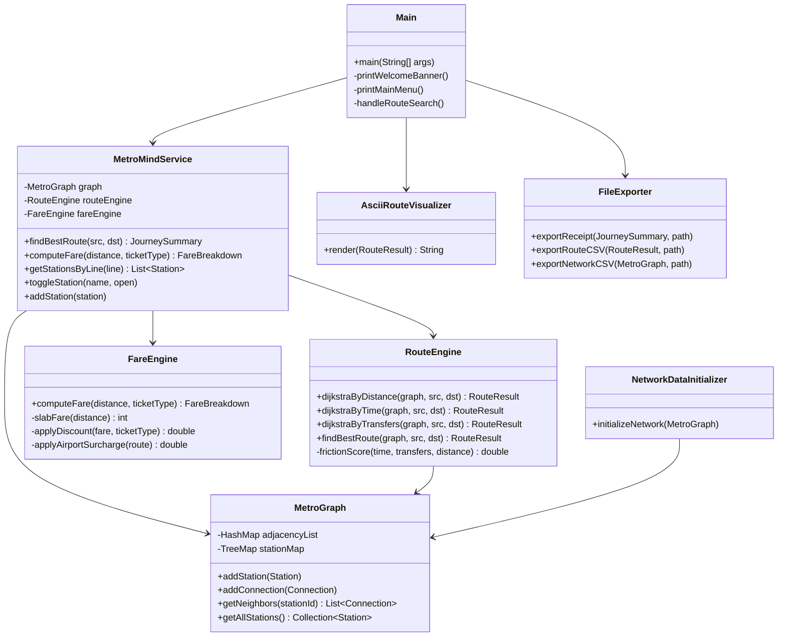
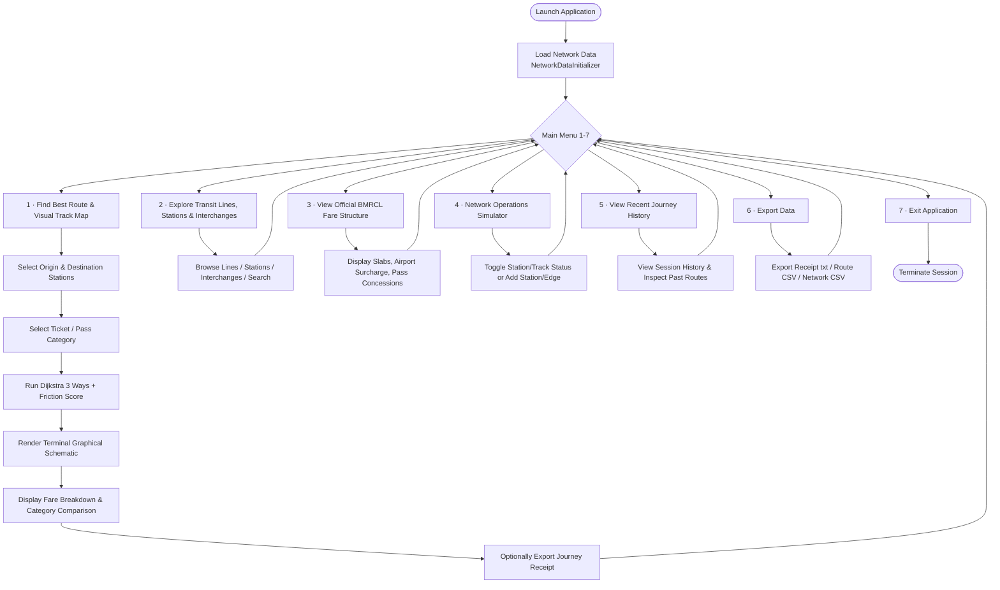

# 🚇 MetroMind: Shortest-Route and Fare Computation Engine

> **Bengaluru Namma Metro / BMRCL Edition**


A graph-based metro routing and fare computation engine for the Bengaluru Namma Metro (BMRCL) network. Built entirely in Java with no external libraries, it implements Dijkstra's algorithm in three variants, a slab-based fare engine, and an interactive console interface covering 63 stations across 5 lines.

---

## Table of Contents

- [Project Overview](#project-overview)
- [Key Features](#key-features)
- [Technology Stack](#technology-stack)
- [System Architecture](#system-architecture)
- [Project Workflow](#project-workflow)
- [Project Structure](#project-structure)
- [Installation & Setup](#installation--setup)
- [How to Run](#how-to-run)
- [Application Walkthrough](#application-walkthrough)
- [Code Explanation](#code-explanation)
- [Sample Execution](#sample-execution)
- [Error Handling & Validation](#error-handling--validation)
- [Limitations](#limitations)
- [Future Improvements](#future-improvements)
- [Learning Outcomes](#learning-outcomes)
- [Documentation Reference](#documentation-reference)
- [Author & Credits](#author--credits)

---

## Project Overview

MetroMind models the Bengaluru Namma Metro network as a weighted directed graph and answers two core questions every commuter has:

1. **Which route should I take?** — Three Dijkstra variants (shortest distance, shortest time, fewest interchanges) are evaluated simultaneously. A *friction score* (`time + transfers × 7 + distance × 0.15`) selects the most practical route rather than the theoretically optimal one.
2. **How much will it cost?** — A slab-based fare engine computes the base fare across six distance brackets (₹10–₹60), applies one of five ticket-type discounts, and adds an ₹20 airport surcharge for KIAL-bound journeys.

The project is designed as a demonstration of core Data Structures & Algorithms (DSA) concepts — graph traversal, priority-queue-based shortest paths, and HashMap/TreeMap data organisation — implemented in idiomatic Java without any framework or dependency.

---

## Key Features

| # | Feature | Description |
|---|---------|-------------|
| 1 | **Best-Route Recommendation** | Runs Dijkstra three ways (distance, time, transfers), then ranks by friction score to recommend the most balanced route |
| 2 | **ASCII Track Schematic** | `AsciiRouteVisualizer` renders a terminal-friendly graphical map of the computed route with station markers |
| 3 | **Slab-Based Fare Engine** | Six distance slabs (₹10–₹60), five ticket types with discounts up to 30%, ₹20 KIAL airport surcharge |
| 4 | **Network Disruption Simulator** | Toggle any station or track open/closed; add new stations and connections at runtime |
| 5 | **Data Exports** | Generate journey receipt `.txt`, route `.csv`, and full network `.csv` to the `exports/` directory |
| 6 | **Journey History** | In-session log of the last 25 journeys with full route and fare details |
| 7 | **Station Search** | Find stations by partial name match — useful when you're unsure of the exact station name |

---

## Technology Stack

| Component | Technology |
|-----------|-----------|
| Language | Java 17+ |
| Build | `javac` (JDK standard toolchain) |
| External Libraries | **None** — pure Java stdlib |
| Graph Implementation | Adjacency list (`HashMap<String, List<Connection>>`) |
| Sorted Collections | `TreeMap` for station/line lookups |
| Algorithm | Dijkstra's with `PriorityQueue` (min-heap) |
| I/O | `Scanner` (console), `PrintWriter` (file export) |
| Platform | Windows (`.bat` scripts) |

---

## System Architecture

### Package & Class Diagram



### Component Layers

```
┌─────────────────────────────────────────────────┐
│                   Main.java                      │  ← Entry point / UI layer
├─────────────────────────────────────────────────┤
│              MetroMindService                    │  ← Facade / orchestration
├────────────────┬────────────────┬───────────────┤
│  MetroGraph    │  RouteEngine   │  FareEngine   │  ← Core logic
│  (graph/)      │  (route/)      │  (fare/)      │
├────────────────┴────────────────┴───────────────┤
│        model/   ·   util/                        │  ← Data model + utilities
└─────────────────────────────────────────────────┘
```

---

## Project Workflow



---

## Project Structure

```
java2/
├── src/
│   ├── Main.java                    # Console app entry point; all menu interaction
│   ├── MetroMindTest.java           # Automated test suite (compile & run separately)
│   │
│   ├── model/
│   │   ├── Station.java             # Station entity (id, name, line, open/closed state)
│   │   ├── Connection.java          # Edge between two stations (distance km, time min)
│   │   ├── MetroLine.java           # Enum: PURPLE, GREEN, YELLOW, PINK, BLUE
│   │   ├── TicketType.java          # Enum: STANDARD_TOKEN, SMART_CARD, SMART_CARD_OFF_PEAK, STUDENT, SENIOR_CITIZEN
│   │   ├── RouteResult.java         # Computed path with total distance, time, transfers
│   │   ├── RouteSegment.java        # One leg of a journey (from, to, line, distance, time)
│   │   ├── FareBreakdown.java       # Base fare, discount amount, surcharge, final fare
│   │   └── JourneySummary.java      # Combines RouteResult + FareBreakdown for history/export
│   │
│   ├── graph/
│   │   └── MetroGraph.java          # Adjacency-list graph; HashMap for edges, TreeMap for station lookup
│   │
│   ├── route/
│   │   ├── RouteEngine.java         # Dijkstra ×3 + friction-score best-route selector
│   │   └── PathNode.java            # Priority-queue node: stationId, cost, path so far
│   │
│   ├── fare/
│   │   └── FareEngine.java          # Slab fare table, discount matrix, airport surcharge
│   │
│   ├── service/
│   │   └── MetroMindService.java    # Facade: routes all calls between UI and core engines
│   │
│   └── util/
│       ├── ConsoleUtils.java        # Input helpers (readInt, readNonEmptyString, etc.)
│       ├── AsciiRouteVisualizer.java# Terminal route schematic renderer
│       ├── FileExporter.java        # Writes receipt .txt, route .csv, network .csv
│       └── NetworkDataInitializer.java # Seeds MetroGraph with 63 stations & all connections
│
├── bin/                             # Compiled .class files (generated by compile.bat)
├── exports/                         # Generated receipts and CSV files
│
├── compile.bat                      # Compiles all sources into bin/
├── run.bat                          # Runs Main from bin/
├── test.bat                         # Runs MetroMindTest from bin/
│
├── README.md                        # This file
├── explain.md                       # Detailed code walkthrough for each class
└── viva_dsa_guide.md                # DSA concepts reference for viva/review
```

---

## Installation & Setup

### Prerequisites

| Requirement | Version |
|-------------|---------|
| Java Development Kit (JDK) | 17 or later |
| Operating System | Windows 10/11 |
| Terminal | Command Prompt or PowerShell |

Verify your Java installation:

```bat
java -version
javac -version
```

### Getting the Project

If cloning from a repository:

```bat
git clone <repository-url>
cd java2
```

Or simply place the `java2/` directory anywhere on your machine — no installation or PATH configuration beyond JDK is required.

### Compile

```bat
compile.bat
```

This runs:

```bat
javac -d bin -sourcepath src src\Main.java src\MetroMindTest.java src\model\*.java src\graph\*.java src\route\*.java src\fare\*.java src\service\*.java src\util\*.java
```

Compiled `.class` files are placed in `bin/`. The `exports/` directory is created automatically on first export.

---

## How to Run

### Run the Application

```bat
run.bat
```

Or manually:

```bat
java -cp bin Main
```

### Run the Test Suite

```bat
test.bat
```

Or manually:

```bat
java -cp bin MetroMindTest
```

The test suite exercises route computation, fare calculation, station lookup, and disruption simulation. All tests print PASS/FAIL to the console.

---

## Application Walkthrough

### Step 1 — Launch

The application loads the full 63-station network at startup and displays a welcome banner with network statistics.

### Step 2 — Find Best Route & Visual Track Map (Menu Option 1)

1. Enter your **Origin Station** name (partial match search and auto-complete supported).
2. Enter your **Destination Station** name.
3. Select your **Ticket / Pass Category** (Token, Smart Card, Off-Peak, Student, Senior Citizen).
4. MetroMind evaluates Dijkstra across distance, duration, and transfer count, computing the commuter friction score to select the single best route.
5. The terminal renders the **Visual Metro Track Schematic** with corridor overview, station milestones, transfer bridges, and journey summary metrics.
6. The full **Fare Computation Breakdown** and a comparative matrix across all pass types are displayed.
7. Prompts whether to export the travel receipt to a formatted text file.

### Step 3 — Explore Transit Lines, Stations & Interchanges (Menu Option 2)

A submenu directory with 6 exploration options:
- View all 5 operational transit lines and their station counts.
- View stations along a specific line.
- View major multi-line interchange hubs (e.g. Majestic, MG Road, RV Road, Silk Board).
- Search station by keyword/partial name.
- Alphabetical directory of all 63 network stations.
- Return to Main Menu.

### Step 4 — View Official BMRCL Fare Structure & Concession Slabs (Menu Option 3)

Displays official distance slab tables (₹10 to ₹60), special corridor rules (+₹20 KIAL Airport Express surcharge), and concession percentages (10% to 30%).

### Step 5 — Network Operations Simulator (Menu Option 4)

- Toggle station maintenance status (close/reopen any station).
- Toggle track segment status (block/unblock direct connection between two stations).
- Add a new metro station to the network dynamically.
- Build a new track connection between two stations.

Rerouting automatically avoids closed stations/tracks in subsequent calculations!

### Step 6 — View Recent Journey History (Menu Option 5)

Displays an audit log of recent journeys planned in the current session (trip ID, timestamp, origin, destination, distance, payable fare), with the option to re-render the graphical track map for any past trip ID.

### Step 7 — Export Data (Menu Option 6)

| Export | File Name | Contents |
|--------|-----------|----------|
| Journey Receipt | `exports/receipt_<JourneyId>.txt` | Formal printed transit ticket with timestamps and segments |
| Route Path CSV | `exports/route_<JourneyId>.csv` | Turn-by-turn route itinerary spreadsheet (Station, Line, Distance, Time) |
| Complete Network CSV | `exports/metro_network_stations.csv` | Full network directory: Station ID, Name, Lines, Interchange Status |

### Step 8 — Exit (Menu Option 7)

Terminates the application with a clean farewell message.

---

## Code Explanation

### `model/` — Domain Entities

| Class | Responsibility |
|-------|---------------|
| `Station` | Immutable station record: ID, display name, `MetroLine`, and an `isOpen` flag toggled by the disruption simulator |
| `Connection` | Directed edge from one station to another with distance (km) and time (minutes) weights |
| `MetroLine` | Enum of the five lines: `PURPLE`, `GREEN`, `YELLOW`, `PINK`, `BLUE` |
| `TicketType` | Enum of five fare categories, each carrying its discount percentage |
| `RouteResult` | Returned by `RouteEngine`: ordered list of `RouteSegment`s, total distance, total time, transfer count |
| `RouteSegment` | One contiguous leg of a journey — same line, from one station to the next |
| `FareBreakdown` | Computed by `FareEngine`: base fare, discount amount, airport surcharge, and final payable amount |
| `JourneySummary` | Aggregates `RouteResult` and `FareBreakdown`; stored in journey history and written to exports |

### `graph/MetroGraph`

The network is an adjacency list stored in a `HashMap<String, List<Connection>>` keyed by station ID. A `TreeMap<String, Station>` provides alphabetical lookup by station name. `MetroGraph` exposes `addStation`, `addConnection`, `getNeighbors`, `getAllStations`, `getStationsByLine`, and disruption-toggle methods. It does not contain any algorithm logic.

### `route/RouteEngine`

Implements three independent Dijkstra runs using a `PriorityQueue<PathNode>` (min-heap):

| Variant | Edge weight |
|---------|------------|
| `dijkstraByDistance` | `connection.distanceKm` |
| `dijkstraByTime` | `connection.timeMinutes` |
| `dijkstraByTransfers` | `0` within same line, `1` on line change |

`findBestRoute` calls all three, computes a **friction score** for each result, and returns the route with the lowest score:

```
friction = totalTimeMinutes + (transfers × 7) + (distanceKm × 0.15)
```

`PathNode` is the priority-queue entry: it holds the current station ID, accumulated cost, and the path list built so far.

### `fare/FareEngine`

Fare is computed in three additive steps:

1. **Slab lookup** — maps total distance to a base fare across 6 brackets:

   | Distance Range (km) | Applicable Slab Label | Base Fare (Standard Token) |
   |---------------------|-----------------------|----------------------------|
   | 0.0 – 2.0           | `0.0 - 2.0 km`        | ₹10.00                     |
   | 2.1 – 5.0           | `2.1 - 5.0 km`        | ₹20.00                     |
   | 5.1 – 12.0          | `5.1 - 12.0 km`       | ₹30.00                     |
   | 12.1 – 21.0         | `12.1 - 21.0 km`      | ₹40.00                     |
   | 21.1 – 32.0         | `21.1 - 32.0 km`      | ₹50.00                     |
   | > 32.0              | `> 32.0 km`           | ₹60.00                     |

2. **Discount** — applied by ticket type:

   | Ticket Type | Concession | Description |
   |-------------|------------|-------------|
   | Standard Token / QR Ticket | 0% | Full base fare single journey token |
   | Namma Metro Smart Card (Varshik / NCMC) | 10% | 10% discount on base fare |
   | Namma Metro Smart Card (Off-Peak / Weekend) | 20% | 20% discount outside rush hours |
   | Student Concession Pass | 25% | 25% discount on base fare |
   | Senior Citizen Pass | 30% | 30% discount on base fare |

3. **Airport surcharge** — ₹20 added when the route includes a station whose name contains `"airport"` or `"KIAL"`.

### `service/MetroMindService`

A facade orchestrating `MetroGraph`, `RouteEngine`, `FareEngine`, and `FileExporter`. `Main.java` interacts exclusively via `MetroMindService`, preserving separation of concerns between console UI and domain logic.

### `util/`

| Class | Responsibility |
|-------|---------------|
| `NetworkDataInitializer` | Populates `MetroGraph` with all 63 stations across 5 lines and all bidirectional edges |
| `ConsoleUtils` | ANSI color definitions, Unicode box characters, clean plain-text fallback, and input validators (`readInt`, `readDouble`, `readNonEmptyString`, `pressEnterToContinue`) |
| `AsciiRouteVisualizer` | Renders the terminal graphical track schematic with corridor overview, transfer bridges, and metrics |
| `FileExporter` | Generates text receipts (`receipt_MM-*.txt`), route CSVs (`route_MM-*.csv`), and network CSV |

### `MetroMindTest`

An automated verification test suite containing 10 comprehensive tests covering network connectivity, direct routing, multi-line interchange transfers, fare slabs, airport surcharge, dynamic disruption rerouting, file exports, and visual schematic rendering.

---

## Sample Execution

Below is a representative session from the live terminal application:

```text
+==========================================================================+
|                   M E T R O M I N D   T R A N S I T   E N G I N E        |
|             Bengaluru Namma Metro  *  Routing & Fare Computation          |
+==========================================================================+

  Operational Network  63 stations  *  5 Namma Metro lines

  +========================================================================+
  |   MAIN NAVIGATION MENU                                                 |
  +========================================================================+
  |  [1]  Find Best Route & Visual Track Map (Graphical Schematic & Fare)  |
  |  [2]  Explore Transit Lines, Stations & Interchanges                   |
  |  [3]  View Official BMRCL Fare Structure & Concession Slabs            |
  |  [4]  Network Operations Simulator (Maintenance, Closures & Rerouting) |
  |  [5]  View Recent Journey History                                      |
  |  [6]  Export Data (Receipts, Route CSV, Network CSV)                   |
  |  [7]  Exit Application                                                 |
  +========================================================================+

  > Select an option [1-7]: 1

  --- Origin Station ---
  > Enter Origin Station: Whitefield
    -> Matched station: Whitefield (Kadugodi)

  --- Destination Station ---
  > Enter Destination Station: Lalbagh
    -> Matched station: Lalbagh

  --- Select Ticket / Pass Category ---
  [1] Standard Token / QR Ticket             (0% discount)
  [2] Namma Metro Smart Card (Varshik / NCMC) (10% discount)
  [3] Namma Metro Smart Card (Off-Peak)      (20% discount)
  [4] Student Concession Pass                (25% discount)
  [5] Senior Citizen Pass                    (30% discount)
  > Choose ticket type [1-5]: 2

+==========================================================================+
|                        VISUAL METRO TRACK SCHEMATIC                      |
+==========================================================================+
|  CORRIDOR OVERVIEW                                                       |
|  [ Whitefield (Kadugodi) ] ==[Purple Line . 11 stops]==> [ Nadaprabhu Kempegowda Station... ] ==[Green Line . 4 stops]==> [ Lalbagh ]|
+==========================================================================+
|  DETAILED ROUTE SCHEMATIC                                                |
|  [START]  Whitefield (Kadugodi)                                          |
|  |   [Purple Line]  2.5 km  3.5 min                                      |
|  o  Sri Sathya Sai Hospital                                              |
|  |   [Purple Line]  2.1 km  3.0 min                                      |
|  o  Hoodi                                                                |
|  |   [Purple Line]  2.4 km  3.5 min                                      |
|  o  Garudacharpalya                                                      |
|  |   [Purple Line]  2.6 km  4.0 min                                      |
|  o KR Puram  [Junction]                                                  |
|  |   [Purple Line]  3.2 km  4.5 min                                      |
|  o  Baiyappanahalli                                                      |
|  |   [Purple Line]  1.5 km  2.5 min                                      |
|  o  Swami Vivekananda Road                                               |
|  |   [Purple Line]  1.1 km  2.0 min                                      |
|  o  Indiranagar                                                          |
|  |   [Purple Line]  3.4 km  5.0 min                                      |
|  o MG Road  [Junction]                                                   |
|  |   [Purple Line]  2.2 km  3.5 min                                      |
|  o  Vidhana Soudha                                                       |
|  |   [Purple Line]  1.8 km  3.0 min                                      |
|  o Nadaprabhu Kempegowda Station, Majestic  [Junction]                   |
|  |                                                                       |
|  +-- INTERCHANGE ------------------------------------------------        |
|  |  <> Nadaprabhu Kempegowda Station, Majestic                           |
|  |  From: Purple Line   ->   To: Green Line                              |
|  |  Walking + dwell: ~4.0 min                                            |
|  +------------------------------------------------------------           |
|  |   [Green Line]  1.4 km  2.5 min                                       |
|  o  Chickpet                                                             |
|  |   [Green Line]  1.2 km  2.0 min                                       |
|  o  Krishna Rajendra Market                                              |
|  |   [Green Line]  1.6 km  2.5 min                                       |
|  [ END ]  Lalbagh                                                        |
+==========================================================================+
|  JOURNEY SUMMARY                                                         |
|  Distance: 27.00 km   Est. Time: ~46 min   Stops: 14   Transfers: 1      |
+==========================================================================+

  --- Fare Computation Breakdown ---
   Selected Category:       Namma Metro Smart Card (Varshik / NCMC)
   Applicable Slab:         21.1 - 32.0 km
   Base Fare:               ₹50.00
   Discount Applied:        -₹5.00  (10% concession)
  --------------------------------------------------------------------------
   FINAL PAYABLE AMOUNT:    ₹45.00
  --------------------------------------------------------------------------

  > Export this journey receipt to a text file? (y/N): y
  [+] Receipt exported successfully to: exports\receipt_MM-1001.txt
```

---

## Error Handling & Validation

| Scenario | Handling |
|----------|----------|
| Station name not found | Message shown; user prompted to search by partial name |
| No route exists (e.g., disconnected graph after disruptions) | `RouteEngine` returns null; service reports "No route available" |
| Source equals destination | Caught before Dijkstra runs; zero-cost result returned |
| Closed station on path | Dijkstra skips closed stations during neighbour expansion |
| Invalid menu choice | `ConsoleUtils.readInt` enforces bounds; re-prompts on bad input |
| Invalid distance / fare input | `readDouble` enforces non-negative bounds |
| File export failure (permissions, missing dir) | `FileExporter` catches `IOException` and prints error without crashing the app |

---

## Limitations

These are known constraints of the current implementation — not bugs:

- **No persistent storage** — all state (journey history, disruptions) is in-memory and lost when the application exits.
- **Alphabetical station order** — `getStationsByLine` returns stations sorted by name (TreeMap), not by their physical sequence along the line.
- **No real-time data** — the network topology and journey times are static; there is no integration with live BMRCL feeds.
- **Session-only history** — the last-25-journeys log exists only for the current run; it is not written to disk.
- **Airport surcharge heuristic** — the ₹20 surcharge is triggered by a station name containing `"airport"` or `"KIAL"`, not by a formal property on the station entity.
- **Windows-only scripts** — `compile.bat`, `run.bat`, and `test.bat` are Windows Batch files; Unix/macOS users must run the `javac`/`java` commands manually.

---

## Future Improvements

The following are design directions, not features that exist today:

- **Persistent storage** — serialize journey history and network state to a local file or embedded database (e.g., SQLite via JDBC) so sessions are resumable.
- **Geographic station ordering** — replace TreeMap with an ordered list that reflects actual line sequence, enabling correct "next station" traversal.
- **Real-time feed integration** — consume GTFS or a BMRCL API to reflect live service alerts and timetables.
- **Multi-modal journeys** — extend the graph with bus/auto feeder connections for first-mile/last-mile planning.
- **GUI front-end** — a JavaFX or web-based map view instead of the ASCII schematic.
- **Unit test framework** — migrate `MetroMindTest` to JUnit 5 for richer assertions, parameterised tests, and CI integration.
- **Fare versioning** — load fare slabs from a config file so they can be updated without recompiling.

---

## Learning Outcomes

### Algorithms

| Algorithm | Where Applied |
|-----------|--------------|
| Dijkstra's Shortest Path | `RouteEngine` — three independent runs per query |
| Priority Queue (min-heap) | `PriorityQueue<PathNode>` in each Dijkstra variant |
| Multi-criteria optimisation | Friction score aggregates time, transfers, distance |
| Graph traversal (BFS-style) | Station search and connectivity checks |

### Data Structures

| Structure | Where Used |
|-----------|-----------|
| Adjacency List | `MetroGraph` — `HashMap<String, List<Connection>>` |
| Min-Heap | `PriorityQueue<PathNode>` in route engine |
| HashMap | O(1) station-ID lookup, visited-node tracking |
| TreeMap | Alphabetically sorted station-name index |
| ArrayList / List | Path accumulation in `PathNode`; route segments |

### OOP Concepts

- **Encapsulation** — each package exposes only what the layer above needs
- **Facade pattern** — `MetroMindService` shields `Main` from internal complexity
- **Enum with behaviour** — `TicketType` carries its discount rate; `MetroLine` carries its display name
- **Immutable value objects** — `FareBreakdown`, `RouteSegment` carry data, no mutation
- **Separation of concerns** — algorithms, data, UI, and I/O live in distinct packages

---

## Documentation Reference

| Document | Description |
|----------|-------------|
| [explain.md](explain.md) | Detailed walkthrough of every class, its fields, methods, and design rationale |
| [viva_dsa_guide.md](viva_dsa_guide.md) | DSA concepts reference — Dijkstra, graph theory, complexity analysis — prepared for viva/review sessions |

---

## Author & Credits

**Project:** MetroMind — Shortest-Route and Fare Computation Engine  
**Network modelled:** Bengaluru Namma Metro (BMRCL)  
**Academic context:** Data Structures & Algorithms course project  

Network topology is based on the publicly available BMRCL metro map. This project is for educational purposes and is not affiliated with or endorsed by BMRCL.
