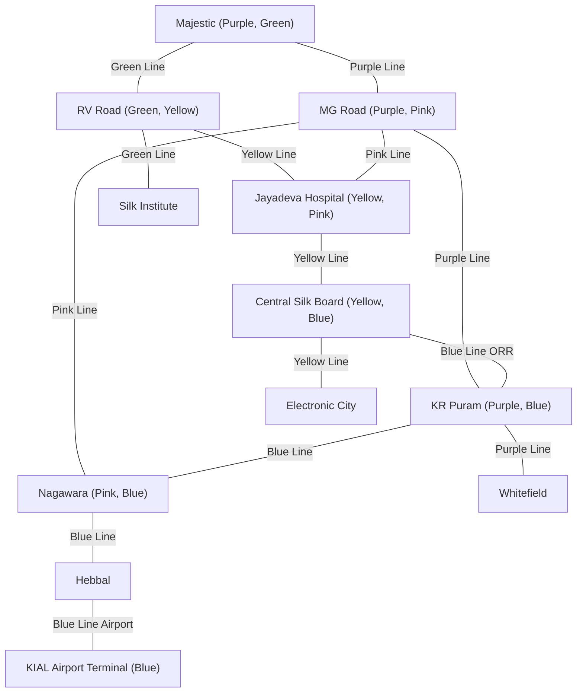

# MetroMind: Shortest-Route and Fare Computation Engine
## Project Code: CP-042 | Domain: Travel, Transport and Logistics
### Bengaluru Namma Metro Edition (BMRCL Network)

---

## 1. What the Solution Is (Executive Summary)

**MetroMind** is an advanced transit pathfinding and dynamic fare computation engine built as a modular, menu-driven console application in pure Java (JDK 17). It represents the **Bengaluru Namma Metro (BMRCL)** urban rapid rail network as a weighted, bidirectional graph.

The solution addresses three central challenges in commuter logistics across Bengaluru:
1. **Multi-Criteria Route Optimization**: Computing the most efficient route between any two Bengaluru metro stations based on:
   - **Shortest Physical Distance** (minimizing kilometers traveled across lines).
   - **Fastest Travel Time** (minimizing actual minutes, including transfer walking and dwell penalties at major hubs like Majestic, MG Road, or Central Silk Board).
   - **Fewest Interchanges** (minimizing train line transfers, prioritized by commuters traveling with baggage or during rush hours).
2. **Dynamic Fare & Ticketing Engine**: Automatically evaluating transit fares across tiered distance slabs matching BMRCL fare policies, applying corridor-specific rules (such as the high-speed **KIAL Airport Express Corridor** surcharge), and factoring in passenger discount matrices (**Namma Metro Smart Card peak/off-peak discounts**, **Student passes**, and **Senior Citizen concessions**).
3. **Resilient Network Management & Disruption Simulation**: Allowing live maintenance toggling (closing stations or tracks for repairs) with automatic real-time rerouting around blockages (e.g. bypassing a closed Majestic station via the Outer Ring Road corridor), dynamic station/track expansion, and export of trip itineraries to printable text tickets and analytical CSV spreadsheets.

---

## 2. Bengaluru Namma Metro Network Architecture

The network model encompasses **63 stations** across **5 key lines** connecting all major IT corridors, residential hubs, transit terminals, and the international airport:

1. **Purple Line (East-West Corridor - Challaghatta to Whitefield)**:
   - Connects *Challaghatta, Kengeri, Mysuru Road, Vijayanagar, KSR Bengaluru Railway Station, Nadaprabhu Kempegowda Station (Majestic), Vidhana Soudha, MG Road, Indiranagar, Swami Vivekananda Road, Baiyappanahalli, KR Puram, Hoodi, Sri Sathya Sai Hospital, Whitefield (Kadugodi)*.
2. **Green Line (North-South Corridor - Madavara to Silk Institute)**:
   - Connects *Madavara (BIEC), Nagasandra, Peenya Industry, Yeshwanthpur, Sandal Soap Factory, Rajajinagar, Mantri Square Sampige Road, Majestic, Chickpet, KR Market, Lalbagh, South End Circle, Jayanagar, RV Road, Banashankari, JP Nagar, Yelachenahalli, Silk Institute*.
3. **Yellow Line (South & Tech Corridor - RV Road to Bommasandra / Electronics City)**:
   - Connects *RV Road, Ragigudda, Jayadeva Hospital, BTM Layout, Central Silk Board, Bommanahalli, Kudlu Gate, Singasandra, Electronic City, Infosys Foundation Konappana, Bommasandra*.
4. **Pink Line (South-North Tunnel & Cantonment Corridor - Kalena Agrahara to Nagawara)**:
   - Connects *Kalena Agrahara, IIM Bangalore, JP Nagar 4th Phase, Jayadeva Hospital, Dairy Circle, Lakkasandra, Langford Town, MG Road, Shivaji Nagar, Bengaluru Cantonment, Tannery Road, Nagawara*.
5. **Blue Line (Outer Ring Road & Airport Express - Silk Board to KIAL Airport Terminal)**:
   - Connects *Central Silk Board, HSR Layout, Bellandur (Ecospace), Kadubeesanahalli, Marathahalli, Doddanekundi, KR Puram, Kalyan Nagar, Nagawara, Hebbal, Yeshwanthpur (ORR Connector), Yelahanka, Doddajala, KIAL Airport Terminal*.

### Key Interchange Hubs in Bengaluru:
- **Nadaprabhu Kempegowda Station, Majestic**: Mega Interchange connecting **Purple Line** and **Green Line**.
- **MG Road**: Interchange connecting **Purple Line** and **Pink Line**.
- **KR Puram (Krishnarajapuram)**: Major IT Hub Interchange connecting **Purple Line** and **Blue Line**.
- **Rashtreeya Vidyalaya (RV) Road**: Interchange connecting **Green Line** and **Yellow Line**.
- **Jayadeva Hospital**: Multi-level Interchange connecting **Yellow Line** and **Pink Line**.
- **Central Silk Board**: Vital junction connecting **Yellow Line** and **Blue Line**.
- **Nagawara**: Interchange connecting **Pink Line** and **Blue Line**.
- **Yeshwanthpur / Hebbal**: Connecting **Green Line** and **Blue Line** (ORR orbital connector).



---

## 3. How the Solution Works (Detailed Component Breakdown)

### 3.1 Network Modeling (Vertices and Edges)
- **Stations (Vertices)**: Represented by `Station.java`. A station holds a name, unique ID, active status flag, and a `Set<MetroLine>`. Stations belonging to multiple lines are automatically recognized as **Interchange Hubs** (`isInterchange() == true`).
- **Connections (Edges)**: Represented by `Connection.java`. A directed edge linking two stations with a physical distance weight (in km), travel duration weight (in minutes), the transit line it belongs to, and an operational flag.

### 3.2 The Routing Algorithms

#### A. Shortest Distance Path
- **Algorithm**: Standard **Dijkstra's Algorithm**.
- **Edge Weight**: `edge.getDistanceKm()`.
- **Operation**: A min-priority queue (`PriorityQueue<PathNode>`) expands the node with lowest cumulative distance. Relaxed distance values are stored in `Map<Station, Double> minCost`. When the destination station is reached, the optimal path is reconstructed backwards through `PathNode.getPrevious()`.
- **Time Complexity**: $\mathcal{O}((V + E) \log V)$ where $V$ is stations and $E$ is tracks.

#### B. Fastest Travel Time (with Interchange Penalties)
- **Real-World Transit Friction**: In transit networks like Namma Metro, switching lines at interchanges (e.g. at Majestic or Silk Board) involves moving between platforms, staircases, and waiting for the next train (typically 3 to 4 minutes).
- **Algorithm**: **State-Expanded Dijkstra's Algorithm**.
- **State Space**: States are keyed by `(Station, CurrentLine)`.
- **Edge Weight**: `edge.getTimeMinutes() + (lineChange ? line.getTransferPenaltyMinutes() : 0.0)`.
- **Operation**: If `current.getCurrentLine() != edge.getLine()`, an interchange transfer penalty is automatically added.

#### C. Fewest Interchanges (Line Transfer Minimization)
- **Commuter Preference**: Passengers with luggage traveling to/from KSR Railway Station or KIAL Airport strongly prefer direct trains or minimal transfers.
- **Algorithm**: **Lexicographical Cost Dijkstra**.
- **Cost Formulation**:
  $$\text{Cost} = (\text{transfers} \times 10,000) + \text{distanceKm}$$
- **Why this works**: By scaling transfers with a large factor ($10,000$), any route with $k$ transfers strictly dominates any route with $k+1$ transfers, regardless of physical distance. Among routes with the same number of transfers, the shortest distance is selected.

### 3.3 Dynamic Fare Computation Engine
The `FareEngine.java` calculates ticket costs dynamically according to distance slabs, airport corridor surcharges, and passenger categories:

#### Distance Slabs:
| Distance Slab | Base Token Fare |
| :--- | :--- |
| **0.0 - 2.0 km** | ₹ 10.00 |
| **2.1 - 5.0 km** | ₹ 20.00 |
| **5.1 - 12.0 km** | ₹ 30.00 |
| **12.1 - 21.0 km** | ₹ 40.00 |
| **21.1 - 32.0 km** | ₹ 50.00 |
| **> 32.0 km** | ₹ 60.00 |

#### Corridor Surcharge:
- **KIAL Airport Express Corridor**: Commuting to/from *KIAL Airport Terminal* adds an infrastructure surcharge of **₹ 20.00**.

#### Concession Rules (`TicketType`):
1. **Standard Token / QR Ticket**: 0% discount (Full fare).
2. **Namma Metro Smart Card (Varshik / NCMC Peak)**: 10% discount on base fare.
3. **Namma Metro Smart Card (Off-Peak / Weekend)**: 20% discount on base fare.
4. **Student Concession Pass**: 25% discount on base fare.
5. **Senior Citizen Pass**: 30% discount on base fare.
- *Calculation Formula*:
  $$\text{Discount Amount} = \frac{\text{Base Fare} \times \text{Discount Percentage}}{100}$$
  $$\text{Final Fare} = \max(\text{Minimum Fare (₹10)}, (\text{Base Fare} - \text{Discount Amount}) + \text{Surcharge})$$

---

## 4. Verification & Core Features Checklist

| Rule Requirement | Implementation in MetroMind (Bengaluru) | Status |
| :--- | :--- | :--- |
| **Language** | Pure Java (JDK 17), zero external build dependencies | **COMPLIANT** |
| **Interface** | Menu-driven console CLI with robust input validation | **COMPLIANT** |
| **Core Feature 1** | Metro Network Modeling & Station Directory (63 stations, 5 lines) | **COMPLETED** |
| **Core Feature 2** | Shortest Route Calculation (Distance-based Dijkstra) | **COMPLETED** |
| **Core Feature 3** | Fastest Travel Time Route (Time-based Dijkstra with transfer penalties) | **COMPLETED** |
| **Core Feature 4** | Fewest Interchanges Route (State-expanded transfer minimization) | **COMPLETED** |
| **Core Feature 5** | Dynamic Fare Engine (Slabs, Airport surcharge, 5 concession classes) | **COMPLETED** |
| **Stretch Feature 1** | Export Journey Receipt to formatted text file (`exports/receipt_*.txt`) | **COMPLETED** |
| **Stretch Feature 2** | Export Turn-by-Turn Route Path to analytical CSV (`exports/route_*.csv`) | **COMPLETED** |
| **Stretch Feature 3** | Export Complete Metro Network Directory to CSV (`exports/metro_network_stations.csv`) | **COMPLETED** |
| **Stretch Feature 4** | Station Maintenance / Disruption Simulator with live rerouting | **COMPLETED** |
| **Automated Tests** | `MetroMindTest.java` running 8 automated unit & integration tests | **100% PASSED** |

---

## 5. Viva / Code Review Preparation (Q&A for Evaluators)

### Q1: How did you model the Bengaluru Namma Metro network in code?
> **Answer**: "We modeled the Bengaluru Namma Metro network as an undirected, weighted graph using an adjacency list. Stations are vertices (`Station`), and physical tracks connecting adjacent stations are edges (`Connection`). The adjacency list is stored in a `Map<Station, List<Connection>>` inside `MetroGraph.java`. Each connection holds physical distance (km), travel time (minutes), and the associated `MetroLine` (Purple, Green, Yellow, Pink, Blue)."

### Q2: Why did you use an Adjacency List instead of an Adjacency Matrix?
> **Answer**: "The Bengaluru Metro network is a sparse graph: with 63 stations, each station connects to on average 2 to 4 tracks. An adjacency list consumes $\mathcal{O}(V + E)$ memory, whereas an adjacency matrix would allocate $63 \times 63 = 3969$ elements, most of which are zeroes. Additionally, exploring adjacent stations during Dijkstra takes $\mathcal{O}(\text{degree}(u))$, which is significantly faster than scanning an entire matrix row."

### Q3: How does your algorithm minimize interchanges between lines like Purple, Green, and Blue?
> **Answer**: "We expanded the state representation in `RouteEngine.java` to `(Station, CurrentLine)`. When traversing from station $u$ to station $v$, if the track's line differs from the line on which the passenger arrived, an interchange occurs. We apply a weighted cost metric: $\text{Cost} = (\text{Transfers} \times 10,000) + \text{Distance}$. The 10,000 multiplier ensures that routes with fewer transfers are prioritized, while distance breaks ties among routes with equal transfers."

### Q4: How are transfer delays handled in travel time calculation?
> **Answer**: "Each `MetroLine` defines a `transferPenaltyMinutes` (e.g. 4.0 minutes). During time-based Dijkstra, whenever a transition switches lines at an interchange hub (e.g., changing from Purple to Green Line at Majestic), the transfer penalty is added to the arrival time. This accurately simulates walking across platforms and waiting for the next train."

### Q5: How does the fare computation engine work?
> **Answer**: "The `FareEngine.java` computes fares across 6 tiered slabs (₹10 for 0-2 km up to ₹60 for >32 km). If the route utilizes the *KIAL Airport Express Corridor*, a ₹20 surcharge is applied. Concessions are then computed based on `TicketType` (10% off for Smart Card, 20% off for Off-Peak, 25% off for Students, 30% off for Senior Citizens), subject to a minimum fare floor of ₹10."

### Q6: What happens if a major interchange like Majestic is closed for emergency maintenance?
> **Answer**: "In `MetroMindService.java`, toggling a station status to inactive makes its connections non-operational. If Nadaprabhu Kempegowda Station (Majestic) is closed, Dijkstra's algorithm automatically navigates around it via the Outer Ring Road corridor (Blue Line via KR Puram, Nagawara, and Hebbal) or via Pink/Yellow line interchanges."

### Q7: What are the time and space complexities of your routing engine?
> **Answer**:
> - **Space Complexity**: $\mathcal{O}(V + E)$ for graph representation and $\mathcal{O}(V \times L)$ for priority queue states, where $L$ is the number of distinct lines passing through stations ($L \le 5$).
> - **Time Complexity**: $\mathcal{O}((V + E) \log V)$ for distance-based Dijkstra using a min-heap. For state-expanded time and transfer routing, it is $\mathcal{O}((V \cdot L + E) \log(V \cdot L))$. With $V = 63$, routing computes in a few milliseconds.

---

## 6. How to Compile and Run

### Option 1: Using Provided Windows Batch Scripts
- **To Compile**:
  ```cmd
  compile.bat
  ```
- **To Run the Interactive Application**:
  ```cmd
  run.bat
  ```
- **To Run the Automated Test Suite**:
  ```cmd
  test.bat
  ```

### Option 2: Using Standard CLI Commands
```powershell
# Compile all Java sources
javac -d bin src/com/metromind/*.java src/com/metromind/**/*.java

# Launch the interactive menu application
java -cp bin com.metromind.Main

# Run the test suite
java -cp bin com.metromind.MetroMindTest
```
